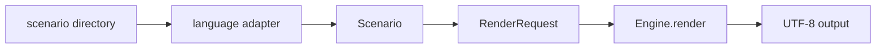
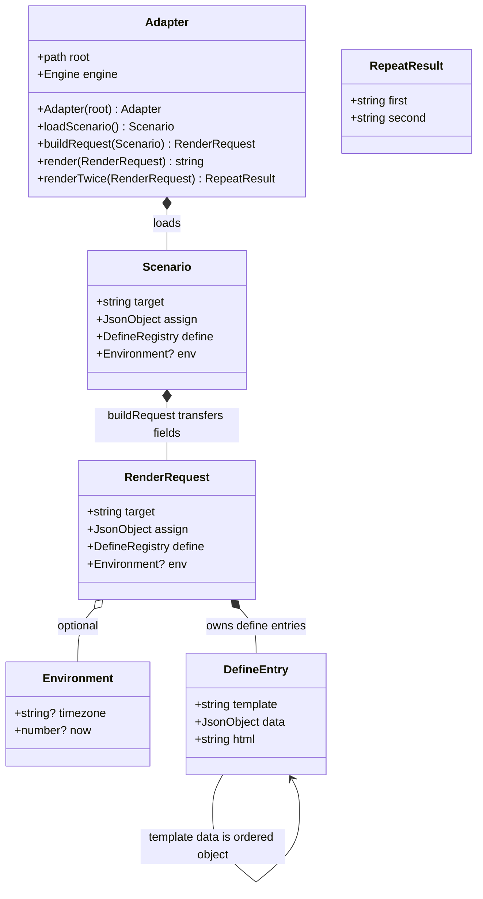
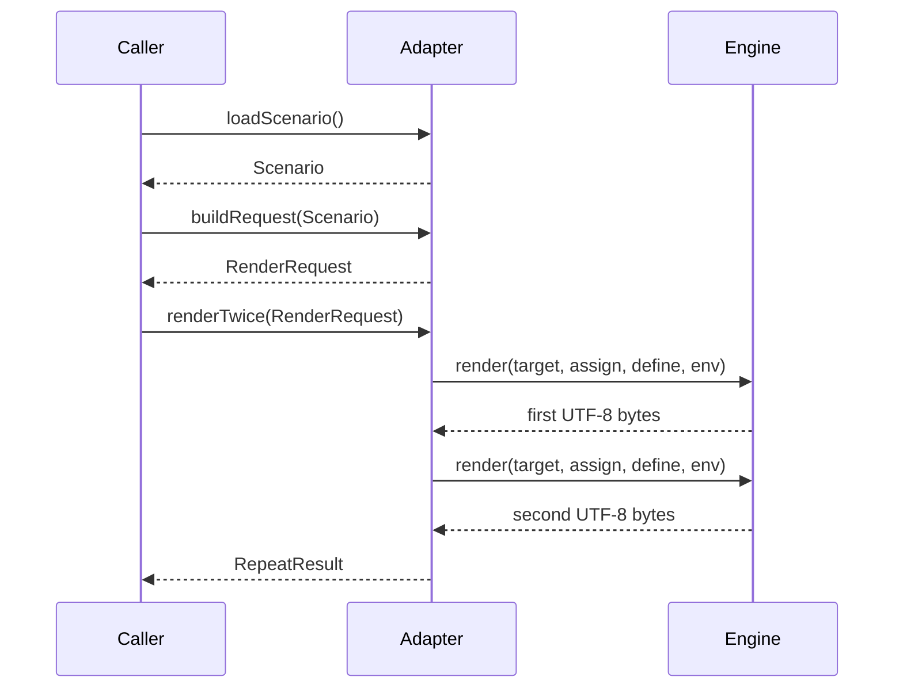
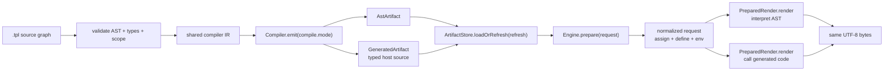
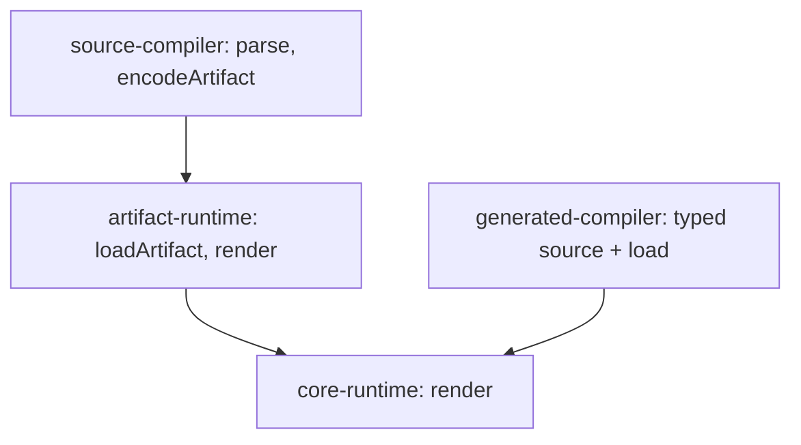

<!-- doc-id: docs-spec-runtime -->
<!-- source-sha256: 15f89261c14ff4708a16d05050885244b0810c8ceb47b3e9e04600927d2ecce0 -->
# 런타임

[English](/spec/runtime).

이 문서는 엔진 API, 템플릿 이름과 로딩, 스코프, 루프, include, 템플릿 define, block 태그, 출력, 제한, 오류 동작, 브라우저 렌더링, 산출물과 페이지 캐시를 정의한다. 값 규칙은 [데이터 모델](/ko/spec/data-model), 표현식 평가는 [표현식](/ko/spec/expressions), 함수는 [함수](/ko/spec/functions), AST는 [AST](/ko/spec/ast), 오류 코드는 [오류](/ko/spec/errors)에 정의되어 있다.

## API

- **RT-1** 모든 구현은 선언한 지원 레벨에 필요한 연산을 제공한다. 이름은 각 언어의 관례를 따르며 같은 레벨을 선언한 구현은 같은 논리 연산을 제공한다.

```
parse(source, name, { delimiters }) -> Template
decodeTemplate(json) -> Template
Engine(options: { loader, functions, limits, delimiters })
program.register(name, fn)
engine.render(target: name | Template, assign, { define, env }) -> string
engine.prepare(target: name | Template, assign, { define, env }) -> PreparedRender
prepared.render() -> string
Loader.load(name) -> { source | ast, version }
Compiler.compile(sourceGraph, mode: ast | gen) -> compiled artifact
ArtifactStore.loadOrRefresh(sourceGraph, refresh: dev | true | false) -> compiled artifact
Engine.prepare(compiled artifact, request) -> PreparedRender
PageCache.get(key) -> string | miss
PageCache.put(key, html, ttl: positive seconds | 0 | null)
PageCache.getOrSet(key, ttl, render)

```

`Engine`은 완성된 `Program` 하나를 받아 표현 방식을 검사하지 않고
`prepare`와 `render`를 위임합니다. `AstProgram`과 `GeneratedProgram`은
이 계약을 독립적으로 구현합니다. compiler와 artifact store가 engine을
만들기 전에 mode와 갱신 정책을 선택합니다.

- **RT-2** `parse`는 다른 템플릿을 로드하지 않고 AST 문서에 정의된 AST를 생성한다. include와 block 태그는 렌더 중에 해석한다.
- **RT-3** `render`는 템플릿 이름 또는 파싱된 템플릿을 받는다. 이름을 받으면 엔진이 로더로 템플릿을 로드한다. 전체 출력을 하나의 문자열로 반환한다.
- **RT-4** `assign`은 호스트 바인딩 규칙으로 변환한 map이거나, 다시 binding하지 않는 bound map(VAL-22)이다. null `assign`(TypeScript의 `undefined`, Go의 `nil`도)과 PHP의 빈 배열은 빈 map이다. `define`은 템플릿 define map(RT-24)이다. `env`는 함수 문서에 정의된 `timezone`과 `now`를 가진 map이다. `define`과 `env`는 각각 생략할 수 있다. 생략한 `define`은 빈 map이다. map이 아닌 `define`이나 `env`는 `AstProgram`의 `prepare`와 `render`에서 `E_DATA_UNSUPPORTED_TYPE`과 메시지 `define is not an object` 또는 `env is not an object`로 실패한다.
- **RT-5** 엔진 옵션의 `functions`와 `register`는 함수 문서에 정의된 대로 호스트 함수를 추가한다. `functions`는 이름에서 호스트 함수로 가는 map이고, 각 항목은 `register`가 추가하듯이 추가된다 (FUN-43, FUN-44). map이 아닌 `functions`나 호출할 수 없는 항목은 TypeScript, PHP, PHP 확장, Python에서 ERR-13의 인자 오류 `functions is not an object` 또는 `functions.<name> is not a function`으로 program 생성에 실패하고, Go와 Rust에서는 옵션의 타입이 함수의 map만 받는다.
- **RT-6** 엔진 옵션의 `limits`는 RT-33의 제한 값을 덮어쓴다. 생략한 제한은 기본값을 유지한다. TypeScript, PHP, PHP 확장, Python의 옵션은 가진 key를 기본값 위에 합치고, Go와 Rust는 `Limits` 값을 기본값인 `DefaultLimits`와 `Limits::default()`에서 시작하므로 비어 있는 제한이 없다. map이 아닌 `limits`, RT-33이 나열하지 않는 key, 정수가 아닌 값은 TypeScript, PHP, PHP 확장, Python에서 ERR-13의 인자 오류 `limits is not an object`, `limits.<key> is not a limit`, `limits.<key> is not an integer`로 program 생성에 실패하고, Go와 Rust에서는 `Limits` 타입이 RT-33의 제한만 정수로 가진다.
- **RT-61** `AstProgram`과 `GeneratedProgram` 모두 `prepare`에서 `assign`을 바인딩하고 `define`과 `env`를 해석하며 target을 선택한다. `assign`이나 템플릿 정의의 `data`로 받은 bound map(VAL-22)은 PHP extension을 포함한 모든 구현에서 다시 binding하지 않는다. 그것을 렌더한 결과는 `bind`를 실행한 시점에 bound map의 항목을 항목으로 가진 호스트 map을 렌더한 결과와 byte가 같다. `merge`의 결과이면 합친 항목을 가진 호스트 map이다. native object의 member만은 템플릿이 읽을 때 읽는다(VAL-19). typed generated program은 bound `assign`을 root record로, bound 정의 `data`를 definition data record로 여전히 변환하며, template을 호출할 때 root record, 정의 data 필드, block scope를 그 순서로 적용한다. 반환된 program별 상태는 동일한 `PreparedRender.render` 연산을 제공한다.
- **RT-62** `PreparedRender.render`는 렌더마다 필요한 scope, output, 실행 상태만 만든다. 입력이 바뀌지 않은 반복 호출은 같은 UTF-8 바이트를 출력한다. `render`는 `prepare(...).render()`와 같으며 단일 호출 편의 연산으로 유지한다.
- **RT-70** 호스트 언어가 코드를 동시에 실행하는 곳에서는, 호스트가 함수와 class를 등록한 뒤 한 program의 렌더가 동시에 실행될 수 있다. 렌더는 program이 load하고 parse한 template만 공유하고, program은 그 cache를 보호한다. Go program은 동시에 실행되는 goroutine에서, Python program은 동시에 실행되는 thread에서 렌더할 수 있고, Python program은 template cache에서만 그 thread들을 직렬화한다. Rust program은 값과 template cache가 `Rc`와 `RefCell`을 쓰므로 `Send`도 `Sync`도 아니다. 그래서 compiler가 program과 그 bound map(VAL-22)을 만든 thread에 둔다. 여러 thread에서 렌더하는 Rust 호스트는 thread마다 program을 만든다. TypeScript와 PHP는 process나 worker마다 한 번에 하나의 렌더를 실행하고, PHP extension은 요청의 object를 그 요청 안에 둔다. 호스트는 렌더하기 전에 함수와 class를 등록한다. 같은 program의 렌더가 실행되는 동안의 등록은 호스트의 data race다. 동시에 실행되는 렌더가 공유하는 program의 loader는 그 렌더들이 동시에 호출한다.
- **RT-65** 페이지 캐시는 컴파일 산출물과 별도로 최종 HTML을 저장한다. 양수 TTL은 해당 시간이 지나면 만료되고 `0`과 `null`은 무기한이다. 캐시 hit는 비즈니스 로직과 템플릿 렌더링을 건너뛴다. 키에는 출력에 영향을 주는 모든 값이 포함되어야 한다.
- **RT-66** `getOrSet`은 hit에서 `render`를 호출하지 않고 캐시 HTML을 반환한다. miss에서는 `render`를 한 번 호출하고 반환된 HTML을 TTL과 함께 저장한 뒤 반환한다.
- **RT-67** 준비된 렌더 계약은 단일 제품 manifest인 [`packages/compiler/interface.json`](https://github.com/polyspec/template/blob/main/packages/compiler/interface.json)에 선언한다. 인터페이스 검사는 필요한 언어 매핑, 지원 수준, 연산이 하나라도 없으면 실패한다.
- **RT-69** `Engine`은 `Program` 하나만 소유한다. generated 실행은 AST 자리표시자, parser, AST renderer를 만들거나 보유하지 않고, AST 실행은 생성 코드를 보유하지 않는다. mode 선택이 engine 안으로 돌아오면 모든 구현의 인터페이스 검사가 실패해야 한다.

program 도표는 단일 제품 manifest에서 생성한다.

```mermaid
<!--@include: ../../packages/compiler/generated/compiler-architecture.mmd-->
```

```mermaid
<!--@include: ../../packages/compiler/generated/compiler-classes.mmd-->
```

compiler manifest는 공개 `Program`, `Engine`, `AstProgram`, generated program 선언 구조도 고정한다. interface gate는 TypeScript는 oxc-parser, Go는 `go/parser`, Rust는 `syn`, PHP는 Reflection으로 읽는다. 연산 누락·추가, 인자 수 변경, 소유자 변경, 구체 AST program 누락이 있으면 빌드가 실패한다.
- **RT-42** 엔진 옵션과 `parse`의 `delimiters`는 렉시컬 문서가 정의하는 대로 태그 구분자를 선택한다. 기본값은 `{}`다. 템플릿 파일의 구분자 지시문은 그 파일에 대해 옵션보다 우선한다.

## 언어 간 렌더 계약

실행 가능한 showcase의 어댑터 경계는 공통 [compiler interface manifest](https://github.com/polyspec/template/blob/main/packages/compiler/interface.json)에 포함한다. 이 manifest는 타입, 필드 순서, nullable 여부, 필수 필드, 소유 관계, 생성자, 연산, 오류, 전제조건, 상태 전이와 언어별 이름 매핑을 선언한다. 각 언어의 native 타입은 이 계약을 표현하며 계약을 다시 설계하지 않는다.





```mermaid
stateDiagram-v2
    [*] --> ready : constructor
    ready --> scenario-loaded : loadScenario
    scenario-loaded --> request-built : buildRequest
    request-built --> rendered : render
    request-built --> rendered : renderTwice
    failed --> request-built : recover after render error
    failed --> request-built : recover after renderTwice error
```



논리적 요청은 다음 JSON 형태다.

```json
{
  "target": "layout",
  "assign": { "title": "Mock title" },
  "define": {
    "layout": "layout.tpl",
    "contents": "content.tpl"
  },
  "env": { "timezone": "Z", "now": 1789084800 }
}
```

- **RT-44** JSON 값은 `null`, boolean, number, string, array 또는 문자열 키를 가진 object다. `assign`은 루트 object다. `define.data`가 있으면 역시 object다.
- **RT-60** Native object instance는 `assign`에 직접 넣을 수 있다. Runtime은 원본 instance를 유지하고 member lookup으로 public field를 노출하며 `object.method(args...)`로 public instance method를 호출한다. 논리 class function은 `Class::method`로 등록하고 `Class::method(args...)`로 호출한다.

## 지원 레벨과 컴파일 artifact

- **RT-55** 구현은 manifest에 지원 레벨을 선언한다. 같은 레벨을 선언한 구현은 같은 논리 타입과 연산을 제공하고, 언어별 표기는 mapping에만 기록한다. 지원하지 않는 연산은 그 레벨에 넣지 않으며 빈 메소드나 runtime fallback으로 만들지 않는다.
- **RT-56** 모든 구현(TypeScript, Go, Rust, PHP, PHP 확장, Python)은 `core-runtime`, `artifact-runtime`과 두 `Program` variant를 제공한다. Build compiler는 `source-compiler`와 generated target backend를 제공한다. JavaScript ESM은 TypeScript backend가 생성하며 별도 의미 구현으로 세지 않는다.
- **RT-59** Render request 경로에서는 parsing, source 탐색, artifact 생성, host compilation을 하지 않는다. 같은 program을 같은 assign, define, environment로 render하면 같은 output byte를 만들고 request를 변경하지 않는다. RT-59는 이 절의 주제인 compiled artifact를 다룬다. AST program은 runtime에 로드하는 템플릿을 RT-76에 따라 갱신한다.
- **RT-76** AST program은 자기 artifact refresh 정책(`artifactRefresh`, `packages/compiler/interface.json`의 `ArtifactRefresh`)을 runtime에 로드하는 템플릿에 적용한다. `dev`에서는 호출마다 템플릿을 다시 로드하고 parse하며, `true`에서는 로더가 그 템플릿에 대해 보고하는 버전이 바뀔 때까지(RT-10) parse를 재사용하고, `false`에서는 첫 parse를 유지하며 runtime에 갱신하지 않는다.

인터페이스는 두 실행 모드를 선언한다.

- **AST 모드**는 정규 AST artifact를 한 번 로드하고 요청마다 `assign`과 `define`을 바인딩해 AST를 해석한다. 완성된 cross-language mode다.
- **생성 모드**는 시작 전에 정규 AST의 각 node를 구현 언어의 renderer로 lower하고 renderer를 한 번 load하거나 연결한 뒤 request마다 호출한다. 모든 구현이 모든 canonical case의 generated 적합성 suite를 통과한다. Request에서 template AST를 parse하거나 해석하지 않는다.

Native object 호출은 AST와 generated runtime에 구현됐다. 전체 mode matrix와 패키지 설치 검사는 모든 구현에서 같은 assign 객체 필드, 인스턴스 메서드와 클래스 함수 동작을 실행한다.


생성과 검증 명령은 다음과 같다.

```sh
node scripts/generate-showcase-contract.mts --check
node scripts/check-showcase-contract.mts
```

지원 레벨 도표도 언어별 선언부와 같은 manifest에서 생성한다.




## 이름과 로딩

- **RT-7** 템플릿 이름은 로더 루트 기준 상대 경로이며 구분자는 `/`이고 앞에 `/`가 없다. `render(name, ...)`으로 렌더하는 템플릿의 이름은 `name`이다. 문자열 target이 `define`의 템플릿 항목과 일치하면 그 항목의 경로를 렌더한다. 따라서 호스트는 `layout: "layouts/page.tpl"` 같은 define으로 레이아웃을 선택할 수 있다.
- **RT-8** include나 block 태그에 쓴 경로는 그 태그를 포함한 템플릿의 디렉터리를 기준으로 해석한다. 앞에 `/`가 있는 경로는 루트를 기준으로 해석한다. `.`과 `..` 세그먼트는 정규화한다. 정규화 후 루트를 벗어나는 경로는 `E_LOAD_OUTSIDE_ROOT`로 실패한다.
- **RT-9** 로더는 이름에 대해 소스 텍스트 또는 파싱된 AST와 버전을 반환하거나, 이름이 없음을 보고하거나, 자기 언어의 오류 방식, 즉 TypeScript와 PHP에서는 던진 예외, Go와 Rust에서는 반환한 오류로 실패를 보고한다. 없는 이름은 `E_LOAD_NOT_FOUND`로 실패한다. 실패는 `E_LOAD_FAILED`로 실패하며 오류 메시지는 로더의 메시지를 포함한다. 엔진은 호스트 함수와 마찬가지로(FUN-46) TypeScript나 PHP 로더가 던진 모든 예외를 잡는다. 로더 결과는 소스 텍스트 또는 파싱된 AST와, 빈 문자열이 아닌 문자열인 버전을 가진다. 빈 문자열은 버전이 없는 것이다. 소스 텍스트도 AST도 없거나 버전이 없는 결과는 로더의 실패다. 즉 `E_LOAD_FAILED`로 실패하며, 오류 메시지는 `template <name> cannot be loaded: the loader returned no source text and no AST` 또는 `template <name> cannot be loaded: the loader returned no version`이다. 소스 텍스트도 AST도 없고 버전도 없는 결과는 소스 텍스트의 메시지로 실패한다. 언어의 타입이 그런 결과의 일부를 불가능하게 만드는 언어는 그 일부를 타입으로 보장한다. 이유: 로더는 엔진이 호출하는 호스트 코드이므로 그 실패는 호스트 함수의 실패처럼 코드와 위치를 가진 템플릿 오류이며, 일부 구현에서만 `render` 밖으로 나가는 예외가 아니다. 없는 소스 대신 빈 소스를 렌더링하거나 버전 없이 템플릿을 보관하는 엔진은 로더가 주지 않은 템플릿을 렌더링하며, 바뀐 템플릿과 바뀌지 않은 템플릿을 구별하지 못한다(RT-40).
- **RT-10** 파일시스템 로더는 `root/name`을 읽고 파일의 수정 시각과 크기를 버전으로 사용한다. `root/name`에서 일반 파일을 찾을 수 없으면, 즉 파일시스템이 경로의 메타데이터를 보고하지 않거나 경로가 디렉터리 또는 일반 파일이 아닌 다른 파일을 가리키면 이름이 없는 것이다. 권한이 읽기를 거부하는 경우처럼 내용을 읽을 수 없는 일반 파일은 실패다(RT-9). 로더는 root 아래 `name`의 각 component를 symbolic link를 따라가지 않고 검사하며, 파일이든 어느 디렉터리든 symbolic link인 component는 실패다(RT-9). link는 따라가지 않는다. 로더는 한 파일에 한 이름을 준다. 파일의 identity는 device와 inode 번호(Windows에서는 volume serial 번호와 file index)이며, 로더가 이미 다른 이름으로 읽은 파일의 이름은 두 이름의 표기와 상관없이 실패다(RT-9). 대소문자를 구분하지 않는 파일시스템이나 hard link가 한 파일에 주는 두 표기도 포함한다. 이유: 따라간 link는 선언된 tree 밖의 파일을 읽고, 한 파일의 두 이름은 그 파일에 cache 항목 두 개를 주며 한 파일을 두 번째 이름으로 include하는 것이 RT-22의 순환 검사를 통과하게 한다. map 로더는 이름과 소스 또는 파싱된 AST를 메모리에 두고 콘텐츠 버전을 사용한다. 컴파일 artifact loader는 파싱된 AST를 보관하고 artifact 해시를 버전으로 사용한다.
- **RT-75** 파일시스템 로더는 읽은 파일을 `load`가 반환하기 전에 닫으므로, 템플릿을 몇 개 로드하든 로더의 파일이 열린 채 남지 않는다. 이유: 많은 템플릿을 로드하거나 오래 실행되는 process가 자기 file descriptor를 소진해서는 안 된다.

## 스코프

- **RT-11** 렌더되는 각 템플릿 파일은 로컬 스코프 하나를 가진다. 파일 안의 블록(`{? }`, `{@ }`)은 스코프를 만들지 않는다.
- **RT-12** 변수는 로컬 스코프에서 먼저 찾고, 다음으로 컨텍스트 데이터에서 찾는다. 루트 템플릿의 컨텍스트 데이터는 `assign`이다. block의 컨텍스트 데이터는 RT-26에 정의한다. 어디에도 없는 이름은 `null`이다.
- **RT-13** 대입 `{:x = e}`는 `x`를 로컬 스코프에 쓴다. 로컬 변수는 같은 이름의 컨텍스트 데이터 항목을 가린다. 대입은 컨텍스트 데이터를 변경하지 않는다.
- **RT-14** 루프 메타(`x.index_` 등)는 이름 `x`에 대해 활성인 루프에서 해석한다. 활성 루프 변수가 아닌 이름의 루프 메타는 `E_RUNTIME_UNKNOWN_LOOP`으로 실패한다.

## 루프

- **RT-15** `{@ v = e}`는 `e`를 한 번 평가한다. list는 원소를 순서대로 키 `0`, `1`, `2`, ...와 함께 반복한다. map은 값을 삽입 순서대로 그 키와 함께 반복한다. `null`은 0회 반복한다. bool, number, string은 `E_RUNTIME_TYPE`으로 실패한다.
- **RT-16** 각 반복은 로컬 스코프에서 `v`를 원소에 바인딩하고 `v`의 루프 메타를 설정한다: `index_`(0 기반 위치), `key_`(list 인덱스는 number, map 키는 string), `value_`(원소), `first_`(첫 반복에서 `true`), `last_`(마지막 반복에서 `true`), `size_`(원소 수).
- **RT-17** 루프가 끝나면 `v`와 그 루프 메타는 루프 전의 값으로 복원한다. 루프 전에 바인딩되지 않았던 이름은 루프 후에도 바인딩되지 않는다.
- **RT-18** 중첩 루프는 바깥 루프의 변수 이름을 다시 사용할 수 있다. 안쪽 바인딩과 메타는 안쪽 루프가 끝날 때까지 적용된다.
- **RT-19** 루프의 `{:}` 분기는 루프가 0회 반복했을 때 실행한다.
- **RT-20** 각 반복은 렌더의 반복 카운터를 증가시킨다. 반복 제한을 넘으면 `E_RUNTIME_LIMIT`으로 실패한다.

## include

- **RT-21** `{+ path}`는 해석된 경로의 템플릿을 로드하고 그 본문을 포함하는 템플릿의 로컬 스코프와 같은 컨텍스트 데이터에서 렌더한다. 포함된 템플릿의 대입은 태그 뒤에서 포함하는 템플릿에 보인다.
- **RT-22** 현재 include와 block 체인에서 이미 렌더 중인 템플릿은 `E_LOAD_CYCLE`로 실패한다.
- **RT-23** 각 include와 각 block은 중첩 깊이를 1 증가시킨다. 깊이 제한을 넘는 깊이는 `E_RUNTIME_DEPTH`로 실패한다.

## block

- **RT-24** `define` map은 식별자를 템플릿 define에 대응시킨다. define은 문자열 경로 또는 `template: path`와 선택적인 `data`를 가진 객체다. `data`는 map이거나 bound map(VAL-22)이다. `html: string`을 가진 객체는 완성된 HTML을 제공한다. `render`에 주는 define의 템플릿 경로는 로더 루트 기준이다. 언어 간 픽스처 형식은 [저장소 도구 문서](../operations/tools.ko.md)에 정의한다.
- **RT-25** `{# id}`는 `id`로 등록된 define을 렌더한다. 등록되지 않은 식별자는 `E_RUNTIME_BLOCK_UNDEFINED`로 실패한다.
- **RT-26** 템플릿 define은 새 로컬 스코프에서, 루트 `assign`, define의 `data`, 태그의 scope 인자 순으로 만든 컨텍스트 데이터로 렌더한다. 같은 이름은 뒤의 출처가 앞의 출처를 덮어쓴다. 호출하는 템플릿의 로컬 변수와 루프 메타는 보이지 않는다.
- **RT-27** HTML 항목은 그 문자열을 이스케이프 없이 출력에 쓴다. HTML 항목에 준 scope 인자는 무시한다.
- **RT-28** `{# id path ...}`는 `id`를 해석된 경로의 템플릿 항목으로 등록한 뒤 렌더한다. `id`가 이미 같은 경로로 등록되어 있으면 등록은 아무 일도 하지 않는다. `id`가 다른 경로나 HTML 항목으로 등록되어 있으면 태그는 `E_RUNTIME_BLOCK_REDEFINED`로 실패한다.
- **RT-29** 식별자 없는 `{# path ...}`는 해석된 경로의 템플릿을 등록 없이 템플릿 항목으로 렌더한다.
- **RT-30** scope 인자 `name:expr`은 `expr`을 호출 스코프에서 평가하고 block의 컨텍스트 데이터에 `name`을 바인딩한다. scope 인자 `name`은 `name:name`과 같다.
- **RT-31** `{?# id}`는 `id`가 등록되어 있으면 본문을, 아니면 `{:}` 분기를 렌더한다. 같은 렌더에서 앞선 `{# id path}` 태그가 한 등록은 보인다.

## 출력

- **RT-32** echo 태그는 safe 문자열을 그대로 쓴다. 그 외 값은 데이터 모델 규칙으로 문자열화한 뒤 `&` `<` `>` `"` `'`를 `&amp;` `&lt;` `&gt;` `&quot;` `&#39;`로 치환해 HTML 이스케이프한다. list나 map은 `E_RUNTIME_STRINGIFY`로 실패한다.

## 제한

- **RT-33** 기본 제한:

| 제한 | Key | 기본값 | 오류 |
| --- | --- | --- | --- |
| 렌더당 루프 반복 | `iterations` | 1,000,000 | `E_RUNTIME_LIMIT` |
| include와 block 중첩 깊이 | `depth` | 32 | `E_RUNTIME_DEPTH` |
| 바이트 단위 출력 크기 | `outputBytes` | 16 MiB | `E_RUNTIME_LIMIT` |
| 표현식 중첩 깊이 | `expressionDepth` | 64 | `E_RUNTIME_LIMIT` |

TypeScript, PHP, PHP 확장, Python은 `limits` 옵션에서 각 제한을 그 key로 적고 Go와 Rust는 언어 관례에 따른 `Limits` type의 field로 적는다. Go는 `Iterations`, `Depth`, `OutputBytes`, `ExpressionDepth`, Rust는 `iterations`, `depth`, `output_bytes`, `expression_depth`이다.

- **RT-34** 표현식 중첩 깊이는 파서와 평가기가 검사한다. 파서는 들어가는 표현식마다 한 level, postfix 표현식(accessor와 call을 가진 operand)마다 한 level, prefix 연산자 `!`나 `-`마다 한 level을 센다. operand 하나는 level 2이고, 괄호 표현식이나 call 인자는 두 level, prefix 연산자는 한 level을 더한다. 그래서 literal을 둘러싼 괄호 31겹은 파싱되고 32겹은 실패하며, 변수 앞의 prefix 연산자 62개는 파싱되고 63개는 실패한다(`tests/fixtures/expr/cases.json`).
- **RT-35** 출력 크기는 출력을 쓰면서 검사한다. 넘으면 렌더가 실패한다.

## 오류

- **RT-36** 렌더 중 오류는 렌더를 중단한다. `render`는 부분 출력을 반환하지 않고 오류 문서에 정의된 오류 객체를 보고한다.
- **RT-37** 두 실행 모드에서 모든 오류 코드는 같은 동작을 가진다. 선택한 모드는 미리 준비된 렌더러 표현만 바꾸며 오류 코드, 요청 구조와 출력 계약은 바꾸지 않는다.

## 브라우저


## 캐싱

- **RT-40** 옵션이 산출물 갱신 정책을 정하지 않은 엔진은 `true`(RT-76)를 쓴다: 템플릿을 `name@version`마다 한 번 파싱하고 로더가 같은 버전을 보고하는 동안 파싱된 템플릿을 재사용한다.
- **RT-41** 파싱된 템플릿은 AST JSON으로 저장하고 다시 로드할 수 있다. AST 렌더는 소스 렌더와 같은 출력을 만든다.

- **RT-72** package는 API의 공개 진입점(`config/parity.json`의 API unit)을 자기 생태계의 진입 방식으로 노출한다: npm package의 exports, Go package의 exported 이름, crate의 공개 항목, Composer package 또는 PHP extension의 class, Python package의 이름. build되거나 설치된 package의 test가 문서가 이름으로 적는 각 진입점을 해석한다.

- **RT-73** API의 연산이 실행 중 읽는 데이터는 자기 생태계가 데이터를 싣는 방식으로 package 안에 실려, 설치된 package가 자기 밖의 파일을 읽지 않는다: AST schema(AST-10)는 npm package의 검증기에 묶이고, Go package(`embed`), crate(`include_str!`), PHP extension에 내장되며, Python 배포물의 package data와 Composer package의 resource로 실린다. package의 test는 repository의 파일이 하나도 없는 곳에서 이 데이터로 decode한다.
- **RT-74** package의 모든 진입점과 모든 module 형식은 같은 runtime을 공유한다: 그 가운데 하나가 만든 bound map(VAL-22)을 다른 모든 것의 program이 받아들이며, module 형식이 하나인 package(Go와 Python의 루트와 하위 package, crate의 module, Composer package의 class)의 진입점도 runtime의 사본을 두지 않는다. npm package는 전체, render 전용, Node.js 진입점의 ECMAScript module 빌드와 CommonJS 빌드를 가진다.
